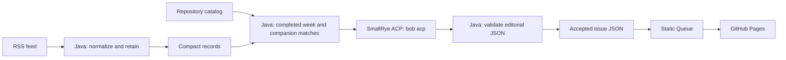

# The Main Thread weekly briefing

A public reading queue for [The Main Thread](https://www.the-main-thread.com). Java collects the RSS feed, retains compact records, asks IBM Bob Shell to assemble a weekly briefing over SmallRye ACP, validates the result, and renders a static site for GitHub Pages.

Readers can filter articles and podcasts, inspect summaries, open originals and mapped companion applications, and remember reading progress in their browser. All visitors have the same access. Every HTML page declares `noindex,follow`; full articles and podcast players remain on the publication.



## Prerequisites

- Java 25 and [JBang](https://www.jbang.dev/download/).
- [IBM Bob Shell](https://bob.ibm.com/docs/shell/getting-started/install-and-setup), tested with **2.0.9**. Use Node.js 24, as recommended in IBM's setup guide and configured in this workflow.
- A Bob API key with access to inference. Use a dedicated CI key for GitHub Actions.

The pinned Java dependencies are SmallRye ACP **0.2.2** and jsoup **1.21.2**. JBang downloads their Maven dependencies on the first run. The workflow pins JBang **0.142.0**, Java 25, Node 24, Bob 2.0.9, and action commit SHAs.

## Run locally

Run these commands from `main-thread-weekly/`:

```bash
jbang Briefing.java test
jbang Briefing.java collect
jbang Briefing.java build
```

`build` uses `BOB_API_KEY` from the process environment. To test with a downloaded Bob key JSON file instead, pass its existing path:

```bash
jbang Briefing.java build --week 2026-W43 --key-file /path/to/downloaded-key.json
```

The JSON file must contain an `apikey` string. The pipeline reads it into memory and passes the value to Bob through its child-process environment. It does not copy the file, save the key, or include it in prompts, issue data, or logs. Keep the downloaded file outside the checkout. Do not put a key in a command argument, `.env` file, GitHub variable, workflow YAML, or committed configuration.

Review the Bob license with `bob --show-license acp` and complete your local Bob setup before running generation. On a disposable environment, `--accept-license` passes Bob's acceptance flag; use it only after reviewing and accepting the license.

The output is `site/index.html`, with stable issue URLs under `site/issues/`. Serve `site/` with any static HTTP server. Do not serve the project root or `state/`. For example, with JDK `jwebserver`:

```bash
jwebserver -b 127.0.0.1 -p 4388 -d "$PWD/site"
```

Open [the local Queue](http://127.0.0.1:4388/). Stop the server with **Ctrl+C**.

### Useful operations

```bash
# Re-render saved issues after a UI change; no Bob key or request required.
jbang Briefing.java render

# Build a specific completed ISO week.
jbang Briefing.java build --week 2026-W43 --timezone Europe/Berlin

# Deliberately replace an accepted issue after reviewing changed inputs.
jbang Briefing.java build --week 2026-W43 --force

# Recover records from a trusted RSS snapshot that still covers the missing period.
jbang Briefing.java collect --feed-file /path/to/feed.xml
```

The default period is the previous completed Monday–Sunday week in `Europe/Berlin`. Selection uses a start-inclusive, end-exclusive interval and handles daylight saving and ISO week years. A Sunday run selects the week completed before the current week.

`--state DIR`, `--site DIR`, and `--assets DIR` change the default directories. `--model ACP_MODEL_ID` requests an explicit model; leave it unset to use Bob's default. `--bob PATH` selects the Bob executable. `--feed HTTPS_URL` selects the final RSS URL; original article links must still point to The Main Thread.

## Configure GitHub Actions and Pages

These instructions target `myfear/the-main-thread`, including its existing Java companion catalog tooling. The workflow is shipped in `github/weekly-briefing.yml`; install it at the repository root:

```bash
cp main-thread-weekly/github/weekly-briefing.yml .github/workflows/weekly-briefing.yml
```

Commit the module and installed workflow. GitHub runs offline checks on changes. Scheduled and manual generation require the workflow to exist on the repository's default branch.

1. Open **Settings → Secrets and variables → Actions → Secrets**. Create the repository secret below.
2. Open the **Variables** tab. Configure the required variables, and any optional ones you need.
3. Open **Settings → Pages → Build and deployment**. Set **Source** to **GitHub Actions**. Keep the publication domain on its current host; this project uses the repository's Pages address.
4. Open **Actions → Weekly briefing → Run workflow**. Select `build`, leave `publish` unchecked, and choose a completed week if needed. Inspect the `weekly-briefing-candidate` artifact, particularly `site/index.html` and `state/issues/YYYY-Www.json`.
5. Run again with `publish` checked. The workflow saves accepted state to `gh-pages` and deploys only `site/` through the official Pages actions. A cached issue does not cause another Bob request.
6. Set `BRIEFING_ENABLED=true` to enable scheduled collection and weekly publication.

### Required secret

| Secret | Purpose |
| --- | --- |
| `BOB_API_KEY` | A dedicated Bob CI API key. It is exposed only to the generation step, through the environment. The local test key is not uploaded automatically. |

### Repository variables

| Variable | Value / default | Purpose |
| --- | --- | --- |
| `BOB_ACCEPT_LICENSE` | `true`, after reviewing the Bob license | Allows Bob to start unattended on a fresh runner. An unset value does not accept the license. |
| `BRIEFING_ENABLED` | `false` when unset | Set to `true` after the first successful publication to enable schedules. Manual runs work while it is unset. |
| `BRIEFING_TIMEZONE` | `Europe/Berlin` | IANA timezone for selecting the reporting week. Set it before your first issue; changing it can change issue inputs. |
| `BOB_MODEL` | Unset | Optional ACP model ID available to your Bob account. Unset uses Bob's default and records that choice as `default`. |

No PAT, Pages API key, model-provider key, or custom `GITHUB_TOKEN` secret is required. The workflow uses GitHub's automatic token. If repository or organization policy restricts Actions, allow the pinned actions, `contents: write` for the state job, and `pages: write` plus `id-token: write` for deployment. The `github-pages` environment may require approval under your existing environment rules.

The daily collection runs at **05:17 UTC**. Weekly generation runs on **Monday at 07:17 UTC**. The reporting timezone is independent of those UTC schedules. GitHub may delay scheduled runs. Both schedules and manual operations share a concurrency group to prevent overlapping state writes.

The expected Pages address is [myfear.github.io/the-main-thread/](https://myfear.github.io/the-main-thread/). The successful deployment job reports the actual URL. The workflow refuses to replace an existing `gh-pages` branch unless it carries this pipeline's ownership marker, `.briefing-state-v1`.

### Manual workflow modes

| Mode | Bob needed? | With `publish` checked |
| --- | --- | --- |
| `collect` | No | Retain source records on `gh-pages`; leave the live site alone. |
| `build` | For a new or explicitly replaced nonempty issue | Collect, select the week, generate or reuse the accepted issue, save state, deploy Pages. |
| `render` | No | Re-render all accepted issues with the current UI and deploy Pages. |

`replace_issue` corresponds to `--force`. A normal rerun reuses an accepted issue only when its input hash matches. Changed source content, model settings, companion mappings, or prompt version require an explicit replacement. Older issues remain unchanged unless selected for replacement.

## Data and generation boundaries

`state/records.json` retains IDs, canonical original URLs, titles, publication dates, media kind, source hashes, capture intervals, and bounded source excerpts: description, headings, and at most about 1,800 characters of prose per record. It keeps at most 5,000 records and 800 capture observations. Full feed XML is not retained by collection. Accepted issues contain the short briefing copy and source facts, without those excerpts.

`gh-pages` is a public Git branch. Its `state/` is durable input for later runs and is public repository data; **only `site/` is uploaded to Pages**. Seven-day candidate artifacts contain the same compact state and rendered site. They contain no raw feed, key file, ACP transcript, thoughts, or raw agent response.

The feed is a rolling source, not a complete archive. The pipeline requires overlapping capture intervals to cover the whole selected week. A single post-week snapshot is enough when it still reaches the beginning of that week. A gap fails generation rather than publishing a potentially incomplete briefing. Recover a trusted snapshot with `--feed-file` and rerun. Absence from a later snapshot does not delete an earlier record. A covered empty week renders a quiet-week issue without calling Bob.

Bob receives bounded records as untrusted data. MCP and subagents are disabled; ACP permission requests are rejected, and any observed tool attempt rejects the run. Only final text chunks are collected. Responses have a five-minute timeout and a 64 KB limit. Java requires exact fields, every known ID once, approved topic labels, bounded plain text, and no model-supplied links or HTML. These checks constrain output shape; they do not establish factual accuracy. The UI labels the briefing as AI-assisted and links to the originals.

SmallRye ACP 0.2.2 handles initialization, sessions, permissions, prompts, timeouts, and process shutdown. Its typed notification router did not expose Bob's final message chunks in the tested combination. `Bob.receive` uses the transport's documented inbound listener to select `agent_message_chunk` messages by their wire discriminator. It discards thought chunks and never logs the frames. Offline checks cover this adapter; the combination has also been tested against Bob Shell 2.0.9.

### Companion links

The workflow runs the repository's existing `ProjectCatalog.java discover` and joins exact `articleUrl` mappings. It does not treat arbitrary GitHub references in an article as companion applications. Locally, provide the same discovery output with `--catalog-file PATH`; a JSON object with a `companions` array of `{ "articleUrl": "...", "projectPath": "..." }` is also accepted. Non-HTTPS or unrelated article mappings are ignored.

This release links mapped code but does not assert current build or test status. The repository's existing build catalog remains the source for that evidence. Podcast links open original listening pages; enclosure size is not used to invent a duration.

### Editorial corrections

Pass `--override PATH` to replace the editorial portion of a selected week without calling Bob. Supply exactly `headline`, `intro`, `connection`, and `items`; each item has `id`, `summary`, `why`, and `topics`. Copy the IDs from the selected source records or accepted issue. The same validation applies. Java continues to own titles, dates, original URLs, and companion URLs. Keep an override outside `site/` and review the resulting issue before publishing it.

## Validation and recovery

`jbang Briefing.java test` runs offline checks for ISO weeks and DST, feed deduplication and audio classification, external entity rejection, URL restrictions, ACP chunk selection and limits, editorial validation, accepted-issue caching, failure preservation, empty weeks, HTML escaping, noindex, and generated local links. It needs no Bob key.

Generation validates and renders a candidate before replacing accepted output. Actions uploads and deploys only after successful generation. A failed run leaves the previous Pages deployment available. If deployment fails after state was saved, run `render` with publication enabled to retry without Bob. To roll back copy or content, restore the relevant accepted issue JSON from an earlier `gh-pages` commit, then render again. To roll back the UI, run `render` from the intended source revision.

If a local process stops during site replacement, inspect `site.previous/` before continuing. The generator refuses to overwrite that recovery directory. Restore it as `site/` if needed, or remove it after confirming which output to keep.

If Bob authentication or startup fails, verify the key's inference access, license acceptance, installed Bob version, and optional model ID. The CLI deliberately suppresses raw third-party exception messages and agent stderr because they can contain source material. Do not enable raw ACP tracing in CI.

## UI assets

The Queue uses The Main Thread wordmark and self-hosted Public Sans headings. The font's license is included in `assets/public-sans-LICENSE.txt`. Reading marks remain in local storage on the visitor's device; storage failure falls back to the current visit. There is no reader account, tracking script, or second subscription service.
